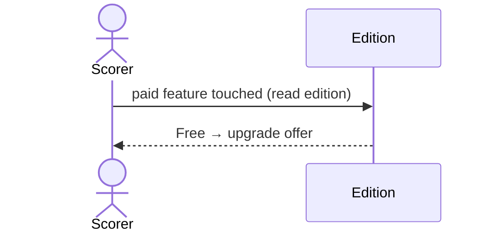

# 52 — Show the upgrade offer

**Type:** AUTO
**Status:** new
**Source:** none
**History:** ADR-0010 (added)
**Actor:** policy (a Free scorer touches a paid feature)
**Trigger / interface:** Touching a paid feature while the edition is Free
**Description:** Shows the scorer what they are missing at the moment they want it.

## Relations
- Triggered by: [1], [7], [8], [11], [14], [15], [16], [18], [19], [21], [22], [36], [38], [39], [40], [43], [44], [46], [47]; [3], [34], [35] at the player cap; [2] choosing another style or break rule
- Triggers: [49], [50]
- Related: [53] (same screen)

## Inputs
- The feature touched

## Rules
- The edition is Free
- **In place:** the templates area (start screen) and the pause button show an "Upgrade now" prompt where they would be
- **Generic screen:** every other paid feature opens one screen, "Upgrade once, forever, to unlock", with Buy (49) and Restore (50)
- Never shown on launch, never repeated as a pop-up

## Flow
1. Scorer taps a paid feature
2. The prompt in place or the generic screen appears
3. Scorer buys (49), restores (50) or goes back

## Failure paths
- none (going back changes nothing)

## Domain Events Raised
- raises nothing (screen)

## Reactions
- none

## Aggregates Touched
- `Edition` (read)

## External Systems
- none

## Sequence Diagram

