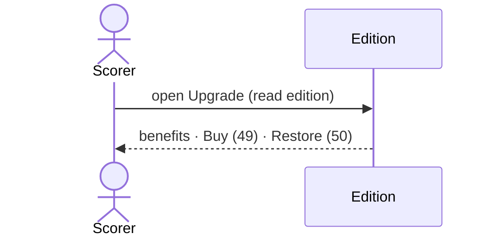

# 53 — See what upgrading unlocks

**Type:** YOU
**Status:** new
**Source:** none
**History:** ADR-0010 (added)
**Actor:** Scorer
**Trigger / interface:** "Upgrade" menu item, shown only while the edition is Free
**Description:** Lists everything the one-off purchase unlocks, with Buy (49) and Restore (50). The generic upgrade screen from 52 is the same page.

## Relations
- Triggers: [49], [50]
- Related: [52]

## Inputs
- none

## Rules
- The menu item shows only while the edition is Free; it disappears on `AppUnlocked` and reappears on `AppLocked`

## Flow
1. Scorer opens the Upgrade menu item
2. Benefits listed: templates, pause, race to and sets, winner breaks, unlimited players, full history, colours, head-to-head, stats, series, several live matches, lock screen
3. Buy or Restore

## Failure paths
- none

## Domain Events Raised
- raises nothing (screen)

## Reactions
- none

## Aggregates Touched
- `Edition` (read)

## External Systems
- none

## Sequence Diagram

