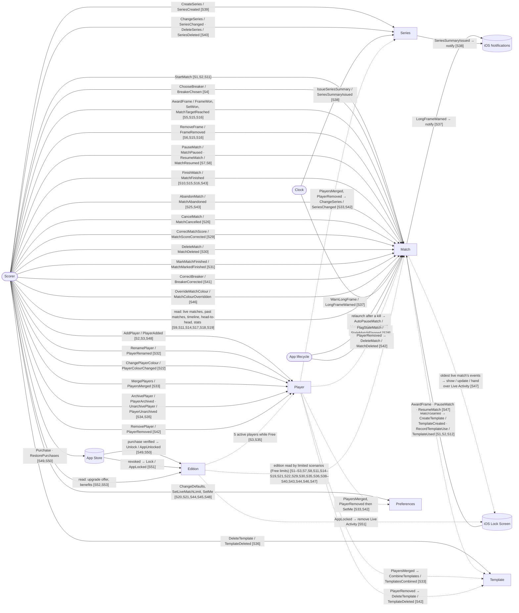

# System Map

Nodes are actors, aggregates and external systems. Edges are commands (solid: actor → aggregate, or aggregate → external) and events/reactions (dashed). Every edge label ends with the scenario numbers that use it, so any edge traces back to its scenario doc. Everything is `(new)`: no code exists yet, so the suffix is omitted from every label.

Conventions: `([ ])` actor · `[ ]` aggregate · `[( )]` external system · solid edge = command · dashed edge = event/reaction · `[S#]` = scenario numbers.

## Index

| Node | Kind | Scenarios |
|------|------|-----------|
| Scorer | Actor | 1–11, 14, 15, 16, 17–22, 25, 26, 29–36, 39–46, 48, 49, 50, 52, 53 |
| Clock | Actor | 37, 38 |
| App lifecycle | Actor | 27, 28 |
| Match | Aggregate | 1–11, 14–19, 25–31, 37, 41, 42, 43, 46, 47 |
| Player | Aggregate | 2, 3, 22, 32–35, 42, 48 |
| Template | Aggregate | 1, 2, 12, 33, 36, 42 |
| Series | Aggregate | 33, 38, 39, 40, 42 |
| Preferences | Aggregate | 2, 18, 19, 20, 21, 33, 42, 44, 45, 48 |
| Edition | Aggregate | 1–3, 7, 8, 11, 14–19, 21, 22, 29, 30, 35, 36, 38–40, 43, 44, 46, 47, 49–53 |
| iOS Notifications | External | 37, 38 |
| iOS Lock Screen | External | 47, 51 |
| App Store | External | 49, 50, 51 |
